  

  
  
  

  
  

---

### SOBRE MIM

<table>
  <tr>
    <td width="50%" valign="top">

**TECNOLOGIA**

Graduanda em Engenharia de Computação 
Desenvolvimento de software 
Jogos e aplicações interativas 
Realidade Virtual aplicada à reabilitação motora 

</td>
    <td width="50%" valign="top">

**PESQUISA E DESIGN**

Pesquisa e inovação em tecnologia (IC e P&D) 
Produção científica: autora e coautora de artigos 
Design gráfico, identidade visual e interfaces 
Voluntária em projetos de design e impacto social 

</td>
  </tr>
</table>

---

### TECNOLOGIAS

  

  

---

### ARTIGOS PUBLICADOS

<table>
  <tr>
    <td>
      
       <b>Princípios de Usabilidade e Gamificação no Design de Exergames: Proposta do Jogo Terapêutico Toque os Alvos</b>
       17º Computer on the Beach
       Aplicação de princípios de usabilidade e gamificação no design do exergame terapêutico Toque os Alvos.
    </td>
  </tr>
  <tr>
    <td>
      
       <b>Proposta de Desenvolvimento de Dispositivo Vestível Baseado em Edge AI para Avaliação Objetiva em Sessões de Fisioterapia</b>
       17º Computer on the Beach
       Proposta de dispositivo vestível com Edge AI para avaliação objetiva em sessões de fisioterapia.
    </td>
  </tr>
  <tr>
    <td>
      
       <b>Fisioterapia em RV: Design de Jogo e Análise de Movimento com Unity e Meta SDK</b>
       17º Computer on the Beach
       Design de jogo e análise de movimento em Realidade Virtual para fisioterapia, com Unity e Meta SDK.
    </td>
  </tr>
  <tr>
    <td>
      
       <b>Comunica: protótipo de aplicativo de comunicação alternativa e aumentativa com recursos de acessibilidade e gamificação</b>
       I Seminário de Gamificação da Amazônia (GameZone)
       Protótipo de aplicativo de comunicação alternativa e aumentativa com acessibilidade e gamificação.
    </td>
  </tr>
</table>

---

### PROJETOS EM DESTAQUE

<table>
  <tr>
    <td width="50%" valign="top">
      <h3>ReabilitaVR</h3>
      Sistema de fisioterapia em Realidade Virtual desenvolvido no PIBIC, com jogos terapêuticos e análise de movimento.
        
      
      
      
    </td>
    <td width="50%" valign="top">
      <h3>Comunica</h3>
      Protótipo de aplicativo de comunicação alternativa e aumentativa com recursos de acessibilidade e gamificação.
        
      
      
      
    </td>
  </tr>
  <tr>
    <td width="50%" valign="top">
      <h3>Amazônia IA</h3>
      Projeto de Inteligência Artificial. Descrição completa em breve.
        
      
    </td>
    <td width="50%" valign="top">
      <h3>Toque os Alvos</h3>
      Jogo terapêutico (exergame) projetado com princípios de usabilidade e gamificação.
        
      
      
      
    </td>
  </tr>
</table>

  

